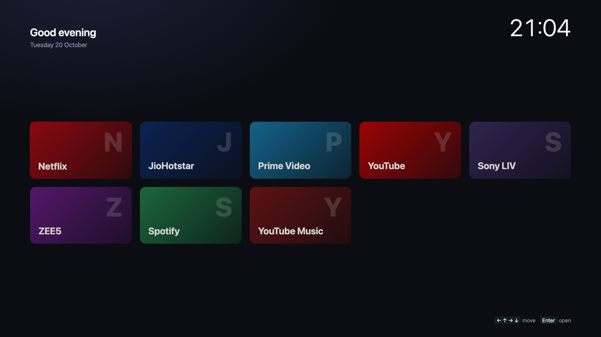
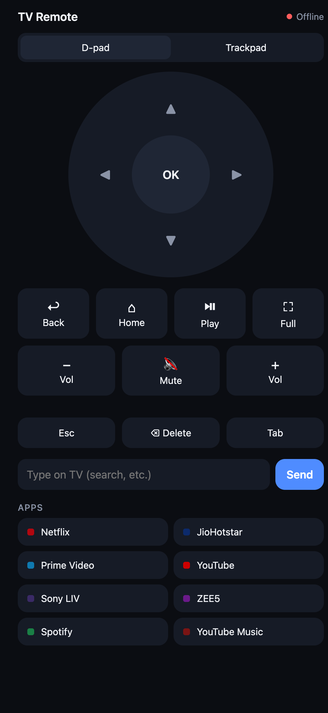

# TV Box

Turn a Mac mini and any monitor into a smart TV — with your phone as the remote.

No streaming stick, no app store, no dependencies: a single Python file serves a TV-style home screen on the Mac and a remote control web app on your phone over Wi-Fi.

<p align="center">
  
  &nbsp;
  
</p>

## Features

- **TV home screen** — full-screen launcher for Netflix, JioHotstar, Prime Video, YouTube and more, navigable with arrow keys.
- **Phone remote** — D-pad, Back, Home, Play/Pause, Fullscreen, volume, and a keyboard for typing searches on the TV.
- **Trackpad mode** — drag to move the pointer, tap to click, two-finger scroll, for sites that aren't keyboard-friendly.
- **Installs like an app** — add the remote to your phone's home screen; it opens full-screen and already paired.
- **Pair by QR code** — scan the code on the TV; only paired phones can control the Mac.
- **Screensaver** — Apple TV's 4K landscape aerials (Yosemite, Iceland, Patagonia, Hawaii…) with a big clock and location caption, plus your own photos in between; starts after 5 idle minutes or from the remote, then goes dark after 10 minutes so the Mac can lock.
- **Lock from your phone** — lock the Mac and switch the screen off; the remote tells you when the Mac is locked.
- **Its own Chrome window** — the TV never takes over your normal browsing windows.
- **Starts at login** — optional LaunchAgent, restarts itself if it crashes.

## Requirements

- macOS (tested on a Mac mini M4, macOS 26)
- Python 3 (standard library only)
- Google Chrome
- Phone on the same Wi-Fi network

## Setup

```bash
git clone https://github.com/shaswat96/tvbox.git
cd tvbox
./start.sh
```

This opens the TV home screen in Chrome. Scan the QR code with your phone to open the remote.

**Grant Accessibility permission** so the remote can press keys and move the mouse:
System Settings → Privacy & Security → Accessibility → enable the app running the server (Terminal if you used `start.sh`).

### Start automatically at login

```bash
./install-autostart.sh
```

Then add the `Python.app` path the script prints to Accessibility (in the file picker, press <kbd>Cmd</kbd>+<kbd>Shift</kbd>+<kbd>G</kbd> and paste it). Remove with `./install-autostart.sh --remove`. Logs go to `~/.tvbox/server.log`.

### Add the remote to your phone's home screen

- **iPhone:** open the QR link in Safari → Share → Add to Home Screen.
- **Android:** Chrome only installs full-screen web apps over HTTPS. Either use Add to Home screen as a shortcut, or enable `chrome://flags` → *Insecure origins treated as secure* for `http://<mac-ip>:8765`, then Install.

Tip: reserve the Mac's IP address in your router so the home-screen icon keeps working.

### Locking and sleep

TV Box works with macOS's normal lock: when the display turns off, the Mac locks per *System Settings → Lock Screen*. The phone **can lock** the Mac but **can't unlock** it. macOS blocks synthetic input on the lock screen, so unlock with the keyboard, Touch ID or an Apple Watch.

If the Mac goes to full sleep, the server sleeps too and the remote shows *Offline*. To keep the remote working while the display is off, turn on *System Settings → Energy → Prevent automatic sleeping when the display is off*. A Mac mini idles at a few watts.

## Customising

Edit [`web/apps.json`](web/apps.json) to change the tiles — each app is a name, URL and colour.

**Screensaver:** plays Apple's landscape aerial videos, streamed in 4K (about 15 Mbps) and relayed through the local server, because Chrome doesn't trust the certificate authority behind Apple's video CDN. If your Chrome can't decode 4K HEVC it switches to 1080p H.264. Drop your own photos into `~/Pictures/TV Wallpapers` (JPEG, PNG, WebP or iPhone HEIC, converted automatically) and they're shown between videos. If the aerials are unreachable it falls back to scenic photos of the day, and offline to animated colour scenes. Press any remote button to leave it. Change `AERIAL_CATEGORIES` in `server.py` to add cities, underwater or space aerials; the idle delay and photo interval are `IDLE_MS` and `SLIDE_MS` in [`web/tv.html`](web/tv.html).

## How it works

| File | What it does |
|---|---|
| `server.py` | HTTP server: serves the pages, checks the pairing token, runs commands |
| `macinput.py` | Posts real keyboard/mouse events through CoreGraphics via `ctypes` |
| `web/tv.html` | TV home screen |
| `web/remote.html` | Phone remote (installable web app) |

Chrome is controlled with AppleScript, volume with `osascript`, and the display is woken with `caffeinate`.

## Security

The server listens on your local network. Commands require a random token (stored in `~/.tvbox/token`, never in the repo) that is only handed out to the TV screen on the Mac itself, via the QR code. Delete that file and restart to un-pair all phones. Don't expose port 8765 to the internet.

## Limitations

- Netflix in Chrome on macOS is capped at 720p.
- Monitors connected over HDMI often have no software volume control — use the monitor's or speaker's buttons.
- The remote's keys go to whichever window is in front; press **Home** first to bring the TV window forward.

## License

[MIT](LICENSE)
